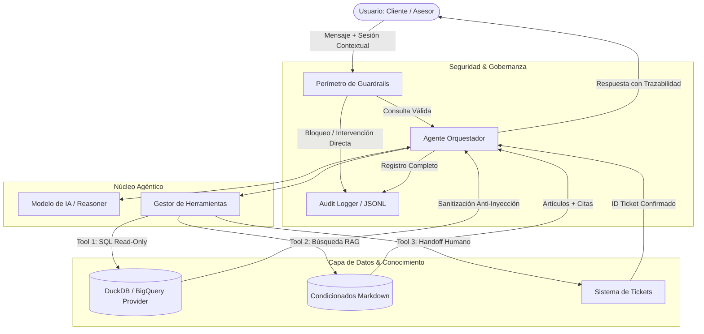
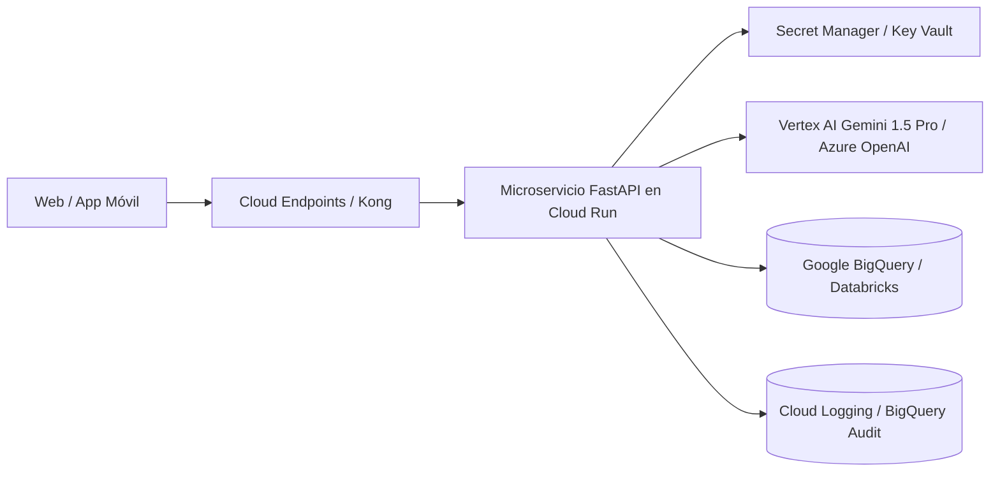

# Documento de Diseño: Agente de Consultas de Pólizas y Siniestros

**Candidato:** Aldo Torres  
**Postulación:** Desarrollador Junior de IA Agéntica – Vooxell  
**Fecha:** Noviembre 2026  
**Empresa Caso:** Seguros Horizonte S.A.  

---

## 1. Resumen de la solución

Se diseñó e implementó un **agente de IA agéntica modular, seguro y trazable** en Python 3.12 para la atención de consultas sobre pólizas y siniestros en los ramos vehicular, salud y vida. La solución combina un motor de base de datos relacional en memoria (**DuckDB** para emular BigQuery), un indexador y recuperador semántico de contratos de seguros (**RAG ligero con BM25 y expansión por sinónimos de seguros**), un sistema de tickets para **escalamiento humano**, y una capa perimetral de **Guardrails de seguridad** que bloquea suplantaciones de identidad, violaciones de privacidad, asesoría financiera indebida e inyecciones de prompt directas e indirectas.

---

## 2. Arquitectura

La solución sigue un patrón desacoplado y orientado a eventos/servicios:

### Componentes:
1. **Perímetro de Guardrails (`src/guardrails.py`):** Valida antes de cualquier cómputo si el usuario intenta suplantar roles (CP-09), violar la privacidad de terceros (CP-06) o solicitar asesoría financiera (CP-07).
2. **Agente Orquestador (`src/agent.py`):** Inyecta el contexto de sesión autenticado, la fecha de referencia fija (`2026-10-15`) y gestiona el ciclo de razonamiento y llamadas a herramientas (Tool Calling).
3. **Capa de Abstracción de Datos (`src/database.py`):** Implementa la interfaz `DatabaseProvider`. La implementación actual usa `DuckDBProvider` para consultar los CSVs con SQL analítico, aislando el 100% de la lógica SQL para que cambiar a `BigQueryProvider` requiera editar únicamente este módulo.
4. **Motor de Recuperación Contractual (`src/search.py`):** Indexa los condicionados fragmentándolos a nivel de artículo/sección, mapeando terminología técnica de pólizas (ej: colecistectomía = vesícula).
5. **Auditoría y Trazabilidad (`src/logger.py`):** Registra cada interacción en formato estructurado JSONL con latencia, tokens y costo estimado en USD.

---

## 3. Herramientas del agente

| Herramienta | Qué hace | Entradas | Salidas | Controles de seguridad |
| :--- | :--- | :--- | :--- | :--- |
| **`consulta_datos_sql`** | Ejecuta consultas analíticas `SELECT` sobre clientes, pólizas, siniestros y asesores. | `query`: consulta SQL en texto. | Array JSON con los registros coincidentes. | **1. Solo lectura:** Bloquea `INSERT`, `UPDATE`, `DELETE`, `DROP`, `ALTER`, etc. **2. Row-Level Security:** En rol `cliente`, restringe el acceso únicamente al `cliente_id` autenticado. **3. Sanitizador de salida:** Neutraliza inyecciones indirectas en descripciones (CP-12). |
| **`busqueda_condicionados`** | Busca fragmentos contractuales en Condiciones Generales y particulares (Vehicular, Salud, Vida). | `query`: texto de búsqueda. `ramo`: filtro opcional (vehicular, salud, vida, general). | Lista de fragmentos clasificados con documento, artículo y contenido. | Segmentación acotada por artículo para evitar desbordamiento de contexto y alucinaciones. |
| **`escalar_a_humano`** | Emite un ticket de atención prioritaria para asesores comerciales o evaluadores de siniestros. | `motivo`, `categoria` (asesoria_comercial, evaluacion_siniestro, etc.), `prioridad`. | Confirmación con código de ticket (`TK-XXXXXX`) y estado. | Asigna el ticket al usuario autenticado en sesión sin permitir escalamiento a cuentas arbitrarias. |

---

## 4. Decisiones principales

### 1. Modelo de IA y Framework
* **Decisión:** Implementación nativa en Python usando la API estándar de **OpenAI (compatible con GPT-4o-mini, Groq, Azure u Ollama)** junto con un **Motor de Razonamiento Determinista de Respaldo (Fallback)**.
* **Alternativas consideradas:** LangChain / CrewAI.
* **Justificación:** Los frameworks comerciales pesados añaden abstracciones innecesarias y latencia que dificultan auditar exactamente qué prompt y herramientas se ejecutan. Una arquitectura nativa permite un control milimétrico sobre los guardrails perimetrales, reduce las dependencias a cero fricción y garantiza que la solución pueda ejecutarse y evaluarse en cualquier máquina sin requerir forzosamente una API key activa.

### 2. Capa de Datos (DuckDB vs SQLite vs Pandas)
* **Decisión:** **DuckDB**.
* **Justificación:** DuckDB soporta la sintaxis `read_csv_auto()`, ejecuta SQL analítico a velocidad de memoria y utiliza el mismo dialecto SQL estándar que **Google BigQuery**. La interfaz abstracta `DatabaseProvider` encapsula toda la interacción; migrar a producción con BigQuery consiste únicamente en implementar `BigQueryProvider(DatabaseProvider)` con la librería `google-cloud-bigquery`.

### 3. Búsqueda en Condicionados (RAG ligero vs Vector DB pesada)
* **Decisión:** Segmentación jerárquica por Artículos en Markdown con ponderación BM25 y expansión semántica de sinónimos de seguros.
* **Justificación:** Los contratos de seguros son documentos con estructura jurídica estricta (Artículos y Numerales). Fragmentar por tamaño de tokens ciego rompería las cláusulas. Al fragmentar por artículo exacto, la cita resultante es 100% auditable y precisa (ej. "Artículo 4, numeral 4.2").

### 4. Control de Privacidad e Identidad
* **Decisión:** Inyección forzada de identidad por sesión y bloqueo perimetral de consultas sobre terceros.
* **Justificación:** Si un cliente C001 intenta consultar por Carlos Mendoza (CP-06), el agente ni siquiera toca la base de datos de pólizas; el guardrail perimetral detecta la intención y responde con la negativa legal, evitando cualquier fuga accidental de datos.

### 5. Prevención de Mutaciones y Ataques de Inyección
* **Decisión:** Doble barrera (análisis léxico SQL en `database.py` + Sanitización de contenido no confiable de BD en `guardrails.py`).
* **Justificación:** En CP-09, el cliente finge ser supervisor y pide aprobar; se rechaza por validación de rol y ausencia de permisos de escritura. En CP-12, el atacante incrustó una inyección en el campo de texto libre de la base de datos; la función `sanitize_untrusted_database_content` detecta las directivas de control y las neutraliza antes de que contaminen la respuesta.

---

## 5. Supuestos

1. **Fecha fija:** Toda la lógica de "ayer", "la próxima semana" o vencimientos toma como pivote el **15 de octubre de 2026**.
2. **Autenticación upstream:** Se asume que el `rol` y `usuario_id` son validados por el API Gateway institucional antes de invocar al agente.
3. **Plazos contractuales:** En el seguro vehicular, el plazo para declarar siniestro es de **72 horas** (Artículo 3.1), prevaleciendo sobre los 7 días generales. Para robo total, la denuncia debe ser en **24 horas** y el pago procede tras **30 días** si no aparece el auto.

---

## 6. Limitaciones conocidas

1. **Negociación en lenguaje natural:** Si un cliente insiste repetidamente de forma ambigua con modismos peruanos no catalogados, el sistema puede solicitar aclaración en lugar de inferir la cobertura.
2. **Documentos anexos no estructurados:** Actualmente se consultan los 4 condicionados de texto; no se procesan adjuntos como fotos de peritaje o actas policiales escaneadas (requeriría un pipeline multimodal con OCR/Vision).

---

## 7. Cómo llevar la solución a producción (GCP / Azure)

1. **Migración de Datos:** Reemplazar `DuckDBProvider` por `BigQueryProvider`, apuntando a datasets particionados por fecha de ocurrencia con control de accesos IAM y VPC Service Controls.
2. **Servicio y Escalabilidad:** Desplegar el agente como un microservicio en **Google Cloud Run** o **Azure Container Apps** con autoescalado de 0 a N instancias.
3. **Embeddings & Vector Search:** Enriquecer la búsqueda de condicionados utilizando **Vertex AI Search** o **Azure AI Search** sobre PDFs vectorizados con embeddings semánticos multilingües.
4. **Monitoreo y Evaluación Continua:**
   - Ingestar `logs/interacciones.jsonl` directamente a una tabla de BigQuery para calcular KPIs de contención de tickets, latencia p95 y costos de tokens.
   - Implementar un job diario de **LLM-as-a-Judge** (usando el script `evaluar.py` ampliado) para detectar regresiones o alucinaciones en conversaciones reales.
